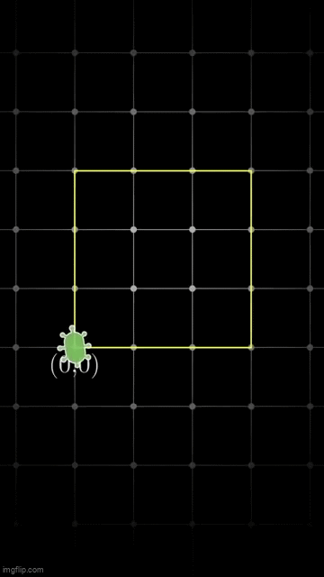

## Problem Statement  

Youtube video explanation [here](https://www.youtube.com/shorts/d0ai33oqqDE).

We have bacteria on a grid. At any point, you can select a bacterium and if the spaces one above and one to the right are both empty it will replicate; the original space becomes empty and the space one above gets a bacterium and the space one right gets a bacterium.  
Only one cell is allowed on a single grid vertex, so if one of those two target vertices are occupied then the chosen bacterium can't replicate.  

Suppose you begin with just one cell at the origin (0,0) and your goal is to eventually clear out the box with corners (0,0), (0,3), (3,3), and (3,0) so that all 16 vertices are empty.  
What is the smallest number of moves required to clear the box?

